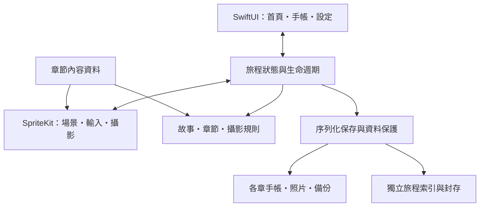

# 技術架構與設計取捨

[回到 Slow Journey](README.md)

## 原生技術如何分工

| 技術 | 責任 | 選用的好處 |
| --- | --- | --- |
| Swift | 遊戲規則、內容模型、狀態與保存 | 型別化資料與可獨立驗證的核心邏輯 |
| SpriteKit | 地圖、角色、碰撞、鏡頭、動態與畫面擷取 | 適合固定視角的 2D 繪本場景 |
| SwiftUI | 首頁、手帳、對話、設定與復原介面 | 使用原生布局、文字與系統匯出能力 |
| Codable／JSON | 章節、故事、對話與存檔 | 內容與規則分開，驗證引用及版本相容性 |
| Swift actor／FileManager | 序列化保存、備份、照片與旅程切換 | 統一處理寫入順序及失敗狀態 |
| AVFoundation／UIKit | 音樂、環境音、中斷與輕量震動 | 配合 App 生命週期與系統音訊政策 |
| XCTest／XCUITest | 核心規則、檔案失敗與實際觸控流程 | 同時驗證資料與操作結果 |

目前沒有第三方程式套件依賴；這不代表所有美術與音訊均由程式作者手工製作。

場景回報移動、互動與攝影等事件，共享狀態協調 UI 和保存。場景不直接決定故事完成，攝影規則也不硬編個別任務名稱。

## 1. 提示和完成判定使用同一份證據

故事條件可以組合指定主體、同張多人照、任意照片、指定地區照片、觀察與休息。手帳提示與完成規則使用同一套條件，因此先拍照再遇見居民仍有效，已有證據也不必再次取得。

好處是擴充故事時能重用規則，同時減少「提示說完成，實際卻不能交談」的落差。可選故事另有明確標記，避免新增支線意外提高既有章印門檻。

## 2. 相機看見的場景和保存的畫面對齊

鏡頭取景與輸出影像使用相同世界矩形。動態居民、動物及列車的主體範圍隨當前節點更新，前景與旅人本身也會影響遮擋判定。

可見比例以幾何取樣估算，換得容易測試、成本可控的判定；它不是逐像素辨識。這項取捨與距離、大小門檻一起構成可解釋的攝影規則。

## 3. 成功保存後才呈現完成

照片先寫入，再連同手帳紀錄保存，成功後才公布照片證據與收納效果；一般寫入失敗會回滾本次照片。跨章、進出室內、整理森林座位與蓋章也把保存結果納入流程。

保存使用 actor 序列化與遞增 revision，阻止延遲到達的舊快照覆蓋新資料。程序在兩步之間中止仍可能留下未引用照片，因此另外提供只讀核對與可還原整理，不用自動刪除掩蓋不確定狀態。

## 4. 重新出發不必抹掉舊旅程

旅程索引指向目前啟用的獨立目錄。另開旅程時先建立並重讀驗證新第一章，最後切換持久索引；原旅程保留原位。每次啟用還有自己的識別，切回同一目錄也不會讓已退役的舊寫入者重新有效。

這讓新旅程、舊照片、各章章印與偏好保持隔離；切換失敗時可保留目前資料。未知索引版本、路徑連結或不可讀內容採停止寫入，而非猜測該覆寫哪份資料。

## 5. 同一份空間資料服務多種系統

道路、地區、碰撞、遮擋、互動位置與攝影主體來自內容和呈現資料，手帳地圖共用道路。內容檢查會驗證 ID、引用、可達性與攝影候選站位，室內門口也納入連通性。

這降低場景外觀、實際通行和地圖說明不同步的機會；自動可達性仍不能替代真人對路線清楚程度的感受。

## 6. 把更新成本放在看得見的地方

靜態植被合併為地面區塊，動態植被限制在鏡頭內並依裝置狀態降低數量；共用貼圖避免重複解碼，相簿以降採樣縮圖載入。動畫時計跟隨場景暫停與前背景切換，走跑步態依實際移動距離推進。

這些設計提供效能控制手段；現階段不以模擬器 CPU 數字推論實際 iPhone 的 GPU、耗電或熱度，也不把步態測試通過當作人物美術已完成。

## 7. 可重現的資料與操作驗證

核心案例涵蓋舊檔遷移、保存失敗、過期寫入者、同名照片衝突、跨章隔離與重複操作；UI 案例在 UUID 隔離旅程中使用搖桿、交談、真正快門及重開。

部分復原測試以明確故障資料建立起點，和正常探索驗收分別記錄。這樣可以驗證罕見錯誤，又不把注入完成狀態當成遊玩成功。
