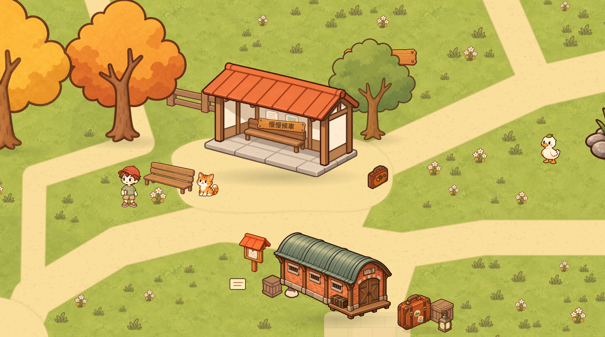
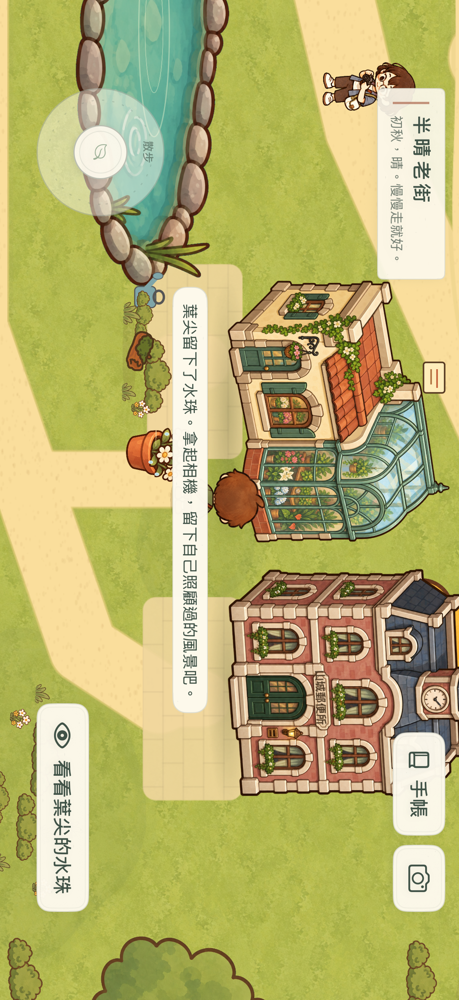
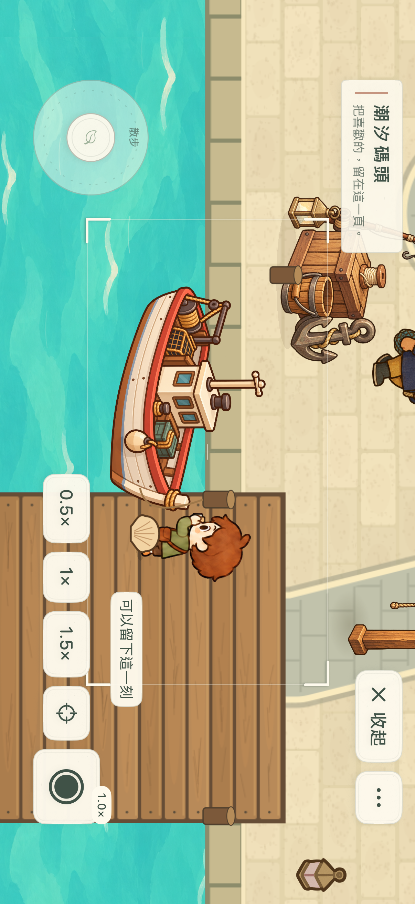
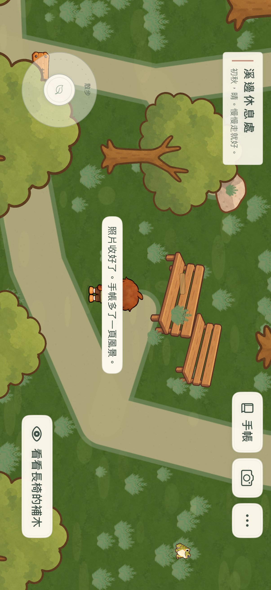
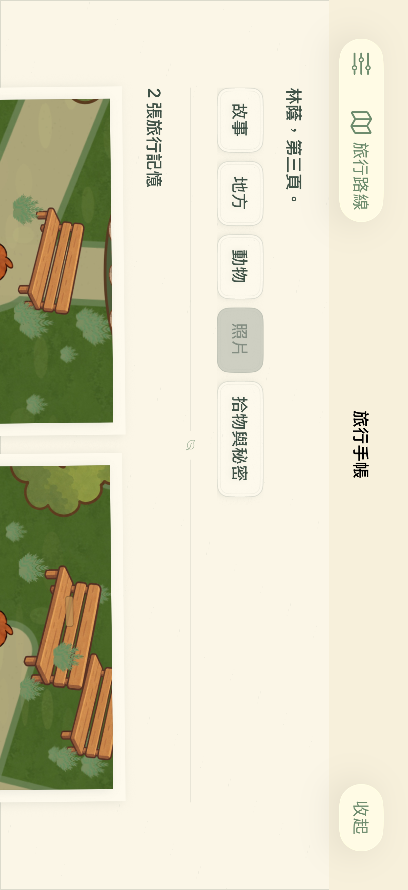
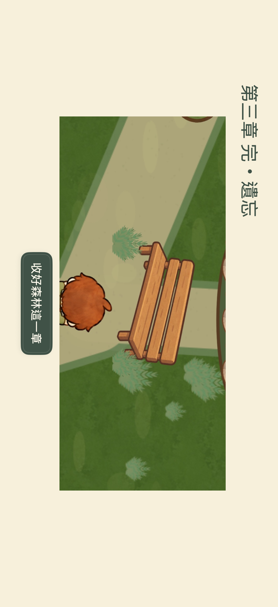
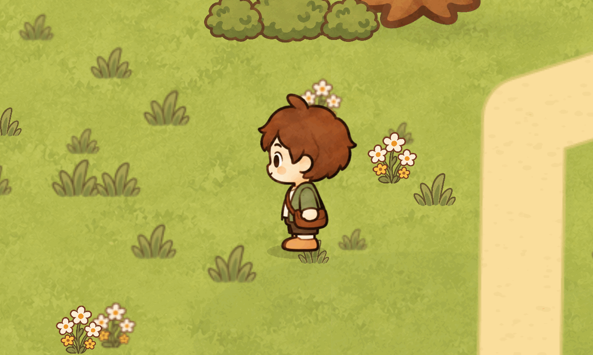

# 畫面與動態展示

[回到 Slow Journey](README.md)

精選畫面來自既有原生渲染與隔離測試旅程，沒有將概念圖當作實際介面。圖片保留當時版本；以下日期是取證批次，不代表全部在本次發布重新拍攝。

## 山城：可以停下來的地方

2026-09-22，SpriteKit 原生場景輸出，未包含 HUD。用於展示候車亭、街景與生活物件的構圖；本圖本身不是完整觸控操作證據。

2026-09-21，iPhone 模擬器實際澆花流程。完成後可自由取景，手帳保存自己的照片。保留當時介面，後續選單已整合。

## 海港：把照片留給故事

2026-09-27，iPhone 模擬器真實取景畫面。顯示遊戲內相機、倍率與當下主體。

同批章末畫面使用已保存的照片，後續可從手帳重看，不是另畫的固定結局插圖。

## 森林：觀察、照料、留下新的紀錄

2026-10-01，iPhone 模擬器正式森林流程，涵蓋實際走路、快門、保存、章末與重開。章節照片是測試旅程中透過遊戲相機取得的影像。

## 旅程封存：保留後再出發

2026-10-01，隔離資料測試的原生設定介面。此流程使用明確的損壞手帳測試起點，用於驗證保留與切回，不是一般玩家存檔，也不是損壞內容已修復的證據。

## 左向走路與小跑

2026-09-26，SpriteKit 原生渲染檢查 GIF，展示左向走跑姿勢。這段是動作檢視，不是完整遊玩錄影，也不代表所有方向的美術已驗收；右向跨動作包包側別仍列為已知問題。
