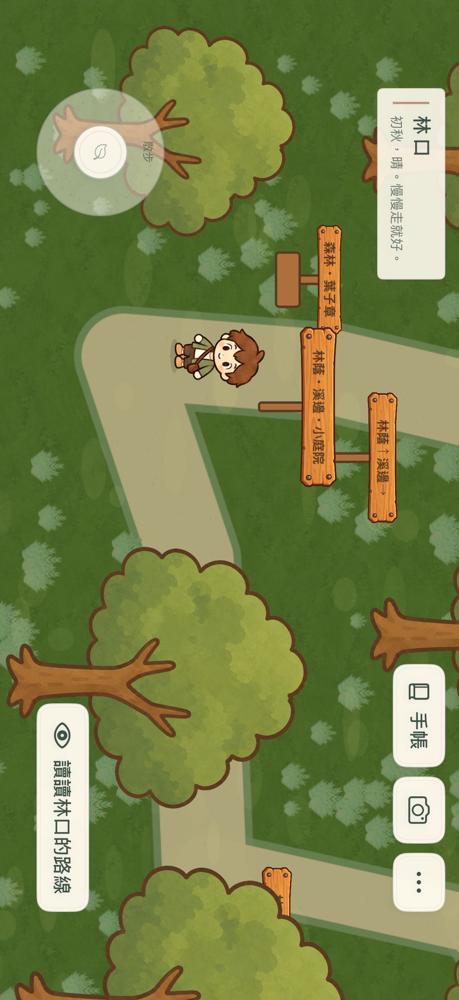

# Slow Journey

**慢慢走，把遇見的人與風景，留進自己的旅行手帳。**

一款以散步、攝影與手帳為核心的原生 iOS 旅行探索遊戲。玩家在手繪風格的山城、海港與森林裡自由走動，透過交談、觀察、聆聽與拍照留下紀錄，讓照片成為故事的一部分。

以 **Swift、SpriteKit、SwiftUI** 開發，iOS 17 以上、iPhone 橫向優先，採離線本機保存，無第三方程式套件。目前前三章已接入可玩流程；全旅程規劃五章，仍在開發中。

*2026-10-01 iPhone 模擬器實際操作畫面。Slow Journey 是穩定的專案展示名稱，遊戲內名稱可隨後續產品命名調整。*

[完整功能](FEATURES.md) · [技術架構與設計取捨](ARCHITECTURE.md) · [畫面展示](GALLERY.md) · [驗證與目前限制](QUALITY.md)

## 為什麼做這個作品

希望讓手機上的探索保留散步的餘裕：可以先走到感興趣的地方，先拍一張照片，再遇見願意聽你分享的居民。沒有戰鬥、生命值或每日任務壓力；收藏與秘密提供繞路的理由，而非每次都必須清空的清單。

技術上的挑戰是把這種自由度做成一致的體驗：先取得的證據仍然有效、提示與完成條件一致、拍到的是當下真正看見的場景，以及切換章節或重新開啟後，仍找得到自己的照片與進度。

## 特色與實際好處

| 特色 | 實際功能 | 帶來的好處 |
| --- | --- | --- |
| 自己決定散步順序 | 章內自由探索，先觀察或拍照也會記住 | 不必依固定接任務順序重做已經發現的事情 |
| 攝影參與故事 | 0.5×～2×取景、主體與遮擋判定、同張合照及選照回顧 | 玩家自己的照片能推進故事，也能留下純粹喜歡的風景 |
| 可以回看的旅行手帳 | 故事、地方、動物、照片、拾物與秘密、旅行路線及章印 | 把探索成果放在同一處，清楚知道走過哪裡、還能做什麼 |
| 三種章節節奏 | 山城居民故事、海港分享與陪伴、森林環境線索 | 相同的核心操作能承接不同的敘事方式 |
| 跨章保存與回訪 | 各章獨立照片與手帳，切換前先保存 | 返回舊地方時，照片與完成紀錄仍然存在 |
| 可保留的重新出發 | 整份旅程封存、另開第一章、切回舊旅程 | 想重新體驗時可以留下既有旅程，而不用直接清除 |
| 舒適度選項 | 左右手布局、字體、搖桿、音量、震動與減少動態 | 讓操作與聲光節奏配合不同使用習慣 |
| Apple 原生技術 | SpriteKit 場景、SwiftUI 手帳與設定、本機資料管理 | 遊戲呈現和系統介面各用合適工具，減少外部套件維護成本 |

## 一次散步如何留下故事

1. 閱讀或略過開場，跟著可略過的引導抵達小站。
2. 用搖桿散步或小跑，走近居民、動物、物件與休息處。
3. 交談、觀察或拿起相機取景，拍下當下場景。
4. 照片保存成功後，手帳與相關故事證據一起更新。
5. 回去分享，或繼續尋找地方留下的痕跡。
6. 完成當章必要內容後蓋章，前往下一站，也能回到先前章節。

## 目前可以玩的三章

| 章節 | 主要內容 | 狀態 |
| --- | --- | --- |
| 山城・相遇 | 四區、五段居民故事、動物與秘密、茶屋、列車攝影、可選澆花 | 已接入正式旅程 |
| 海港・等待 | 碼頭、市場、燈塔及港口街區，三段原有故事、照片分享主線、可選夫妻合照與小屋謎點 | 已接入正式旅程 |
| 森林・遺忘 | 四區環路、三段環境線索、整理與休息、前後兩張照片、三頁手帳與葉子章 | 已接入正式旅程 |
| 老街・回憶／離島・告別 | 後續章節 | 尚未實作 |

「已接入」表示有可操作、保存與回訪的流程；不表示全遊戲完成、真機效能已驗收或全部美術已定稿。

## 代表性技術工作

- **讓攝影與任務共用證據規則**：提示、已完成條件與實際判定保持一致，減少重複拍照與矛盾提示。
- **保存成功才公布結果**：照片、整理場景、蓋章與跨章切換都考慮寫入失敗，避免畫面顯示完成卻沒有留下紀錄。
- **防止舊工作覆蓋新資料**：序列化寫入、遞增版本與旅程啟用識別共同管理非同步保存。
- **以實際場景支援攝影**：動態居民、動物和前景位置同步到取景評估；幾何遮擋近似的範圍明確可驗證。
- **按需要更新場景細節**：靜態草花合併、貼圖重用，動態量依鏡頭、低耗電與熱狀態調整。

## 關於這個 repository

這是**作品與技術展示**，提供功能說明、設計取捨、驗證範圍與精選畫面。完整 App 原始碼、素材庫和開發歷史保存在獨立私有 repository，此處不提供安裝包，也不代表已在 App Store 或 TestFlight 發行。

展示包含原生程式繪製、AI 輔助製作及依各自授權使用的美術／音訊；公開畫面不授予其中角色、音樂或第三方素材的再利用權。沒有發布開源授權。開發者：[eltonchung](https://github.com/eltonchung)。
